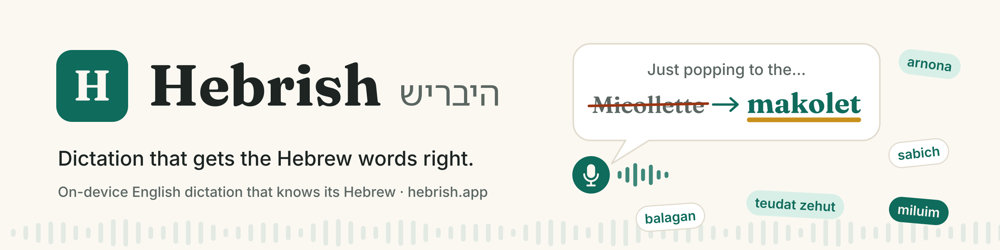

**Dictation that gets the Hebrew words right.**

Hebrish is a one-person project building open speech tools for code-switched English–Hebrew: English speech with Hebrew words mixed in, as used by English-speaking immigrants in Israel and across the Jewish world. Stock English models mangle the Hebrew words in an English sentence. The Hebrish speech recognition models write them in one consistent romanized spelling and run on the device, so no audio is sent anywhere. A text-to-speech model, Meorav, works the other way: it reads code-switched English aloud and pronounces the Hebrew words correctly.

## Watch: how the training data is recorded

Daniel on camera: how the takes the models are trained on are recorded ([YouTube](https://www.youtube.com/watch?v=RWTDqKSKOQE); more videos at [hebrish.app/updates/videos](https://hebrish.app/updates/videos)).

## The models

The models are named after Israeli favourites. This table is the inventory: which models are maintained, how they are updated, what each is for and where it runs. It is generated from the same data as [hebrish.app/models/inventory](https://hebrish.app/models/inventory) and the [Hebrish Models Space](https://huggingface.co/spaces/Hebrish/Hebrish-Models), so the three always agree.

<!-- model-inventory:begin -->
> Every model here can still be downloaded, and access requests for the older and less maintained ones are still approved. The up-to-date models (marked Recommended) are strongly recommended: they are the ones still being trained, so they recognise the widest vocabulary.

### Speech to text

Speech recognition (ASR): dictation, streaming and voice commands. [hebrish.app/models/asr](https://hebrish.app/models/asr)

| Model | Status | Use case | Updates | Platforms | In the Hebrish apps | Latest | Last release |
|---|---|---|---|---|---|---|---|
| [Sabich](https://huggingface.co/Hebrish/Sabich-Rolling) | **Recommended** · Active | Dictation (speech to text) | Rolling: retrained from the latest weights as new recordings arrive | Android, Linux, Windows, macOS | Android + Desktop | Sabich v5.1 | 2026-11-19 |
| [Falafel](https://huggingface.co/Hebrish/Falafel) | **Recommended** · Active | Voice commands | Updated alongside Sabich | Android, Linux, Windows | Android + Desktop | Falafel v1.1 | 2026-11-16 |
| [Jachnun](https://huggingface.co/Hebrish/Jachnun) | Available as is · Occasional updates (use [Sabich](https://hebrish.app/models/sabich) instead) | Dictation (speech to text) | Occasional updates, no schedule | Browser, Linux, Windows, macOS | No | Jachnun v1.0 | 2026-10-19 |
| [Sabich-Canary-Qwen-2.5B](https://huggingface.co/Hebrish/Sabich-Canary-Qwen-2.5B) | Available as is · Frozen (use [Sabich](https://hebrish.app/models/sabich) instead) | Dictation (speech to text) | None planned | GPU server | No | Sabich-Canary-Qwen-2.5B v1.0 | 2026-10-21 |
| [Sabich-Parakeet-110M](https://huggingface.co/Hebrish/Sabich-Parakeet-110M) | Available as is · Frozen (use [Sabich](https://hebrish.app/models/sabich) instead) | Dictation (speech to text) | None planned | Android, Low-power / wearables | No | Sabich-Parakeet-110M v1.0 | 2026-10-21 |
| [Sabich-Qwen3-ASR-1.7B](https://huggingface.co/Hebrish/Sabich-Qwen3-ASR-1.7B) | Available as is · Proof of concept (use [Sabich](https://hebrish.app/models/sabich) instead) | Dictation (speech to text) | None: a one-off experiment | GPU server | No | Sabich-Qwen3-ASR-1.7B v1.0 | 2026-10-21 |
| [Sabich-asr4all](https://huggingface.co/Hebrish/Sabich-asr4all-S) | Available as is · Frozen (use [Sabich](https://hebrish.app/models/sabich) instead) | Dictation (speech to text) | None planned | Low-power / wearables | No | Sabich-asr4all-S and -M v1.0 | 2026-10-21 |
| [Shakshuka](https://huggingface.co/Hebrish/Shakshuka) | Available as is · Occasional updates | Streaming dictation | Retrained now and then while its accuracy is worked on | Linux, Windows | Desktop | Shakshuka v2.2 | 2026-11-17 |
| [Whisper Hebrish](https://huggingface.co/danielrosehill/Whisper-Hebrish) | Legacy · Superseded (use [Sabich](https://hebrish.app/models/sabich) instead) | Dictation (speech to text) | None | GPU server | No | Version 2 | 2026-10-17 |
| [Whisper Hebrish Small ACFT](https://huggingface.co/Hebrish/Whisper-Hebrish-Small-ACFT) | Legacy · Superseded (use [Sabich](https://hebrish.app/models/sabich) instead) | Dictation (speech to text) | None | Android | No | small-en-en30-acft | 2026-10-17 |
| [Fritter](https://huggingface.co/Fritter-ASR/Fritter) | Separate project · Active | Dictation (speech to text) | Regular incremental updates | Linux, Windows, macOS, Android | No | Fritter v1.2 | 2026-11-05 |
| [Gefilte](https://huggingface.co/Hebrish/Gefilte) | Separate project · Proof of concept | Dictation (speech to text) | Early development | Linux, Windows, Low-power / wearables | Desktop | Gefilte PoC-1 | 2026-11-17 |

### Text to speech

Speech synthesis (TTS). [hebrish.app/models/tts](https://hebrish.app/models/tts)

| Model | Status | Use case | Updates | Platforms | In the Hebrish apps | Latest | Last release |
|---|---|---|---|---|---|---|---|
| [Meorav](https://huggingface.co/Hebrish/Meorav) | **Recommended** · Active | Text to speech | New versions as the TTS work moves on | GPU server | No | Meorav v3.0 | 2026-11-15 |
| [Meorav-Daniel](https://huggingface.co/Hebrish/Meorav-Daniel) | Available as is · Frozen | Text to speech | None planned | GPU server | No | Meorav-Daniel v1.0 | 2026-11-15 |
| [Meorav-Multi-Voice](https://huggingface.co/Hebrish/Meorav-Multi-Voice) | Available as is · Frozen (use [Meorav](https://hebrish.app/models/meorav) instead) | Text to speech | None planned | GPU server | No | Meorav-Multi-Voice v1.0 | 2026-11-16 |

### Accessory models

Text tools that support the speech models. [hebrish.app/models/accessory](https://hebrish.app/models/accessory)

| Model | Status | Use case | Updates | Platforms | In the Hebrish apps | Latest | Last release |
|---|---|---|---|---|---|---|---|
| [Hebrew-Gendered-Sentence-Creator](https://huggingface.co/Hebrish/Hebrew-Gendered-Sentence-Creator) | Available as is · Work in progress | Accessory (text tools) | In development | GPU server | No | v3 (work in progress) | 2026-11-18 |
| [Hebrew-Latin Token Classifier](https://huggingface.co/Hebrish/Hebrew-Latin-Token-Classifier) | Available as is · Frozen | Accessory (text tools) | None planned | Linux, Windows, macOS, GPU server | No | v1 | 2026-10-15 |

Generated 2026-11-19 from [hebrish.app/models/inventory](https://hebrish.app/models/inventory) ([JSON](https://hebrish.app/data/model-inventory.json)).
<!-- model-inventory:end -->

On-device builds (sherpa-onnx, ONNX, GGUF, MLX) are in their own `-<format>` repos under [huggingface.co/Hebrish](https://huggingface.co/Hebrish). Gated repositories approve access requests automatically once you accept the terms. The apps download the models from Hebrish's own CDN and need no access request. Model pages and benchmarks: [hebrish.app/models](https://hebrish.app/models).

So far the models are trained on one speaker's voice. Want them to learn yours? [Contribute recordings](https://hebrish.app/support).

## Get the app

| Platform | Install |
| --- | --- |
| Android (recommended) | F-Droid: [add the Hebrish repository](https://fdroid.hebrish.app/repo?fingerprint=EF8C2D63D994A10CD489A978585510B47E47452EC09248591CB2C0F39C2BC1FA), then search for **Hebrish** |
| Android | Direct APK: [hebrish.app/get/android](https://hebrish.app/get/android) |
| Linux (Ubuntu) | `.deb`: [hebrish.app/get/ubuntu](https://hebrish.app/get/ubuntu) |
| Windows | `.zip`: [hebrish.app/get/windows](https://hebrish.app/get/windows) |

The download links always point at the latest release. All releases: [Hebrish-App releases](https://github.com/Hebrish-ASR/Hebrish-App/releases).

### F-Droid

1. Install [F-Droid](https://f-droid.org/) (or Droid-ify / Neo Store).
2. On your phone, open [this link](https://fdroid.hebrish.app/repo?fingerprint=EF8C2D63D994A10CD489A978585510B47E47452EC09248591CB2C0F39C2BC1FA) with F-Droid and confirm **Add repository**.
3. Search for **Hebrish** and install it. Updates then arrive like any other app's.

To add it by hand: **Settings → Repositories → +**, repository `https://fdroid.hebrish.app/repo`, fingerprint `EF8C2D63D994A10CD489A978585510B47E47452EC09248591CB2C0F39C2BC1FA`. Full instructions with a QR code: [hebrish.app/download](https://hebrish.app/download#fdroid).

## Repositories

| | |
| --- | --- |
| Website | [hebrish.app](https://hebrish.app) |
| Apps (Android, Linux, Windows) | [Hebrish-App](https://github.com/Hebrish-ASR/Hebrish-App) |
| Keyboard | [Hebrish-Keyboard](https://github.com/Hebrish-ASR/Hebrish-Keyboard): HeliBoard fork with Hebrish dictation in the mic key |
| F-Droid repository | [Hebrish-FDroid](https://github.com/Hebrish-ASR/Hebrish-FDroid) |
| Models overview | [Hebrish Models Space](https://huggingface.co/spaces/Hebrish/Hebrish-Models) |
| Models and datasets | [huggingface.co/Hebrish](https://huggingface.co/Hebrish) · [full collection](https://huggingface.co/collections/Hebrish/hebrish-english-hebrew-code-switching-6ad6143c7de198780425709f) |
| Benchmark | [English-Hebrew-Codeswitching-ASR-Benchmark](https://github.com/Hebrish-ASR/English-Hebrew-Codeswitching-ASR-Benchmark) |
| Full index | [English-Hebrew-Code-Switching-Index](https://github.com/danielrosehill/English-Hebrew-Code-Switching-Index) |

Developed by [Daniel Rosehill](https://danielrosehill.com) · [contact](https://www.danielrosehill.com/contact/form).
